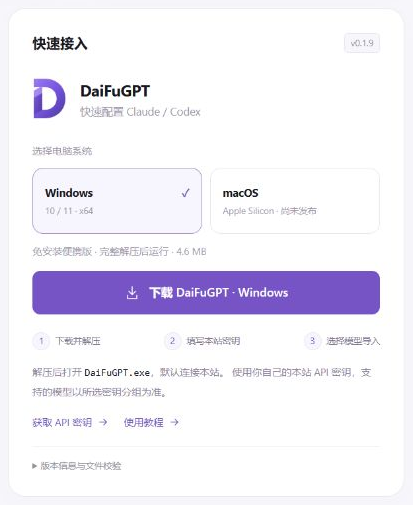

<p align="center"></p>

<h1 align="center">DaiFuGPT</h1>

<p align="center">连接你的 AI 工具。选择站点、选择 Claude 或 Codex、填写个人密钥、获取模型，然后导入配置。</p>

<p align="center"><strong>v0.1.9</strong> · <a href="https://github.com/Sparking-svg/daifugpt/releases/tag/v0.1.9">下载</a> · <a href="https://github.com/Sparking-svg/daifugpt/issues">反馈问题</a> · <a href="https://daifu.men/">官网</a> · <a href="https://daifu.men/dashboard">账户工作台</a> · <a href="https://daifu.men/home#docs-connect">使用文档</a> · <a href="LICENSE">MIT 许可</a></p>

## 下载与使用

安装包通过 [GitHub Releases](https://github.com/Sparking-svg/daifugpt/releases/tag/v0.1.9) 分发，网站工作台的下载按钮将接入同一版本附件。

| 系统 | 下载文件 | 打开方式 |
| --- | --- | --- |
| Windows 10 / 11 · x64 | [Windows 免安装 ZIP](https://github.com/Sparking-svg/daifugpt/releases/download/v0.1.9/DaiFuGPT.zip) · 0.1.9 | 完整解压，打开 `DaiFuGPT/DaiFuGPT.exe` |
| macOS · Apple Silicon | 待发布 | 先使用官网的手动接入教程 |

Windows 版为免安装便携包，需要 Microsoft Edge WebView2 Runtime，无需另装 Node.js 或 Rust。软件名称、窗口标题、下载包及包内程序均为 **DaiFuGPT**。[SHA-256 校验文件](https://github.com/Sparking-svg/daifugpt/releases/download/v0.1.9/SHA256SUMS.txt) 与安装包位于同一版本下。

### 配置步骤

1. **选择站点**：默认选中 DaiFuGPT，核对地址为 `https://daifu.men`。
2. **选择客户端**：按需要选择 Claude 或 Codex，以及对应的桌面版、终端版或编辑器入口。
3. **填写个人密钥**：在[本站 API 密钥页](https://daifu.men/keys)创建密钥，回到软件获取该密钥允许使用的模型。
4. **选择模型并导入**：勾选所需模型、指定默认模型，核对导入内容后确认。

导入后完全退出目标客户端，再重新启动并新建会话。需要撤回时选择“恢复原配置”。仅关闭或删除 DaiFuGPT 不会自动恢复客户端配置。模型和协议以密钥所属分组为准。

## 支持的客户端

| 客户端 | 配置内容 |
| --- | --- |
| Codex 桌面版与终端版 | 本地 provider、API 认证与所选模型目录 |
| Claude Code 终端版 | 用户配置、API 地址与模型选项 |
| Claude Code · VS Code | 支持范围内的扩展与 Claude Code 配置 |
| Claude 桌面版 | 支持第三方推理模式的客户端配置 |

本站密钥权限由后台分组决定；客户端入口不代表每个分组都支持全部客户端。Windows 程序用于 Windows 本机环境；WSL、Remote SSH 等环境需各自配置。

## 配置与数据

- 默认站点为 DaiFuGPT，也可在工具中管理站点。
- 导入会写入所选客户端的本地配置，操作前核对预览与备份提示。
- 恢复记录使用独立的 `.daifugpt` 用户目录，不自动迁移原工具的恢复记录。
- 恢复记录与客户端认证文件可能包含凭据，请保存在自己的电脑中。
- 支持深浅色界面，使用紫色渐变大写 **D** 图标。

## 网站快速接入

登录[账户工作台](https://daifu.men/dashboard)，在“快速接入”卡片选择电脑系统、下载对应版本，也可进入 API 密钥页和使用教程。

<p align="center"></p>

上图为工作台卡片的本机预览。GitHub 下载已发布，网站下载按钮在本次统一更新上线后生效。

## 版本与验证

当前版本 **0.1.9** 已完成 Windows release 编译、18 项前端测试、TypeScript 检查、压缩包结构及产品名称核验，并核对下载文件的字节数与 SHA-256：

```text
6714e134d79b2581ad061c574b9bdd99da5cdc5d5b1f23e08ca9214b722c3161  DaiFuGPT.zip
```

本衍生构建尚未完成全部客户端端到端导入、对话及工具调用验证，尚未进行 Windows 发布者代码签名。模型目录读取和配置写入成功不等于全部功能已验证。详见 [VERIFICATION.md](VERIFICATION.md)。

## 问题反馈

反馈时提供操作系统、DaiFuGPT 版本、目标客户端版本、操作步骤和经过遮盖的错误提示。账户额度、模型权限及计费问题请通过[本站帮助入口](https://daifu.men/home#guide)处理。

请勿在公开 Issue、截图或日志中附上 API 密钥、密码、完整认证文件或恢复记录。

## 开源与来源

DaiFuGPT 基于 [SuperGPT Connect v0.1.6](https://github.com/superpilot69/supergpt-connect/tree/v0.1.6) 制作，调整应用名称、品牌图标和默认站点，沿用其客户端配置引擎。

原项目采用 MIT 许可。本发行包保留原项目及第三方版权和许可证说明，详见 [LICENSE](LICENSE) 与 [THIRD-PARTY-NOTICES.md](THIRD-PARTY-NOTICES.md)。本项目独立维护。
